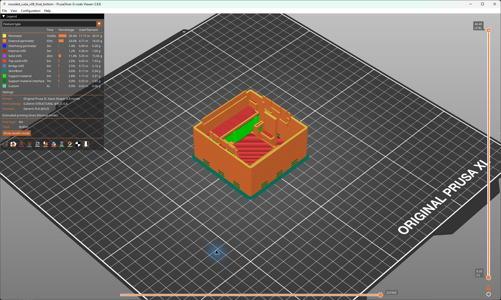
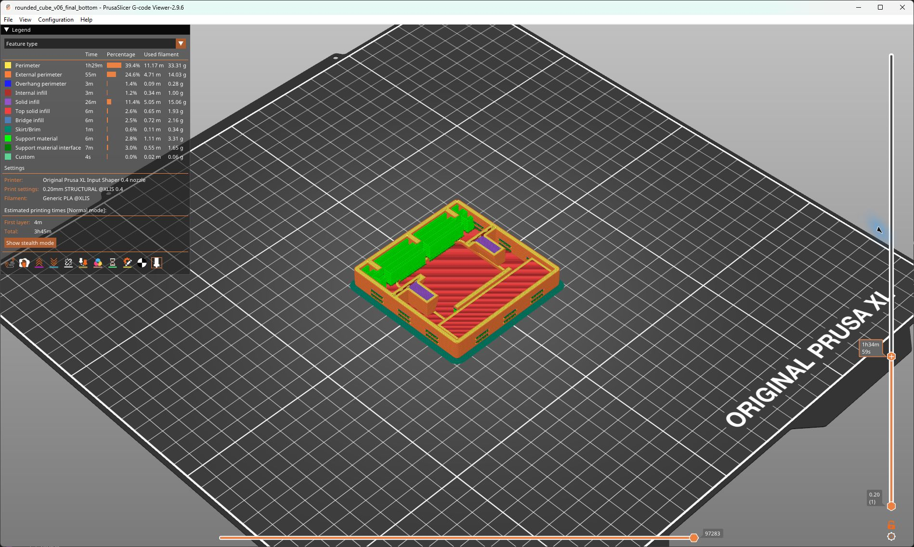

# Rounded Cube Box v06: Prusa XL / 0,4 mm / PLA

See juhend on uue tugevdatud **alumise poole v06** jaoks. Uue STL-i ava on juba ülespoole. Varasema v05 STL-i asend on teistsugune.

## 1. Kõige lihtsam: ava valmis PrusaSliceri projekt

1. Ava PrusaSlicer ja vali **File → Open Project** (Ctrl+O).
2. Ava `output/rounded_cube_box/rounded_cube_bottom_xl_pla.3mf`.
3. Kui programm küsib, kas laadida projekt või ainult geomeetria, vali **projekt koos seadistustega**. Ainult geomeetria import ei too prindisätteid kaasa.
4. Vali printeriks enda XL-i peade arvule vastav **Original Prusa XL … Input Shaper 0.4 nozzle**. Valmis kontrollprojekt kasutab standardset 0,4 mm düüsi ja üht aktiivset tööriista. Kahe või viie peaga XL-il vali vastav printeriprofiil ning PLA-ga tööriist 1 ja viiluta uuesti.
5. Filamendiks vali **Generic PLA** XL-i profiil. Konkreetse PLA tootja profiili kasutamisel järgi selle temperatuurivahemikku; kontrollitud näites on 230 °C esimene kiht, 220 °C järgmised kihid ja alus 60 °C.
6. Kontrolli allolevat tabelit ka pärast printeri- või filamendiprofiili muutmist. Kui programm pakub muudetud prindisätete ülekandmist, säilita projekti prindisätted.
7. Mudeli põhi peab olema vastu alust ja **avatud külg ülespoole**. Detaili mõõt peab olema **76 × 76 × 44,4 mm**. Ära pööra uut v06 STL-i 180 kraadi. Hoidikud ja neli krõpsukeelt on ülevalt nähtavad.
8. Vajuta **Slice now**. Võrdle eelvaadet selle juhendi lõpus oleva pildiga ja ekspordi G-code oma printerile.

Alusta ühe alumise poole prooviprindiga. Kokkupandud mudeli eelvaate STL-i ei kasutata printimiseks.

## 2. Alumise poole täpsed sätted

Kui kasutad ainult STL-i, ava `rounded_cube_bottom.stl`, vali üleval paremal **Expert** režiim ja alusta profiilist **0.20mm STRUCTURAL**. Seejärel sisesta järgmised väärtused. Kiirused ja kiirendused jäta XL-i STRUCTURAL profiili omaks.

| Koht / PrusaSliceri välja nimi | Väärtus alumise poole jaoks |
| --- | --- |
| Printer | Prusa XL Input Shaper, standardne 0,4 mm düüs |
| Layer height | 0,20 mm |
| First layer height | 0,20 mm |
| Perimeters | 4 |
| Top solid layers / Bottom solid layers | 6 / 6 |
| Fill density / Fill pattern | 15% / Grid |
| First layer speed | 40 mm/s |
| Brim width / Brim separation gap | 5 mm / 0,10 mm |
| Brim type | Outer brim only |
| Elephant foot compensation | 0,20 mm |
| Generate support material | Sees |
| Auto generated supports | Sees |
| Support on build plate only | **Väljas**; toe algus võib olla karbi sisepõrandal |
| Style | Snug |
| Overhang threshold | 40° |
| Pattern / Pattern spacing | Rectilinear / 3,0 mm |
| Top contact Z distance | **0,25 mm** |
| Bottom contact Z distance | **0,25 mm** |
| Top interface layers / Bottom interface layers | 2 / 2 |
| Interface pattern / Interface pattern spacing | Auto / 0,30 mm |
| XY separation between an object and its support | **0,50 mm**, mitte 50% |
| Closing radius | 1,0 mm |
| With sheath around the support | Väljas |
| Don't support bridges | Väljas |
| Raft layers | 0 |
| PLA nozzle temperature, first / other layers | Kontrollprojektis 230 / 220 °C |
| Bed temperature, first / other layers | 60 / 60 °C |

Tugede väljad asuvad **Print Settings → Support material**. Kihid ja perimeetrid: **Layers and perimeters**; täidis: **Infill**; brim: **Skirt and brim**. Temperatuurid: **Filament Settings → Filament**. Mõni nimi võib programmi keele või versiooni järgi pisut erineda.

Alumise poole puhul ära vali põhivaates valikut **Support on build plate only**: suletud põrand takistab alusel algavate tugede jõudmist sisemiste riiulite alla. Vali **Everywhere**, seejärel kasuta tabeli Snug- ja kontaktivahede sätteid. Automaatne tuvastus ei tähenda, et kogu sisemus täidetakse tugedega.

Kontrollitud näites on tugi- ja liidesekihtide materjali kokku umbes **5 g**, kogu detail koos brim'i ja tugedega **73,13 g**, hinnanguline aeg **3 h 44 min 53 s**. v05 alumisel poolel oli umbes 37 g tugimaterjali ja kogukulu 97,27 g. Need on PrusaSliceri hinnangud, mitte mõõdetud prinditulemused.

## 3. Kihtide eelvaate kontroll enne printimist

- Vaata **Feature type** värve: oranž/kollane on detaili seinad; roheline on eemaldatav tugi. Füüsiliselt prinditakse need sama PLA-ga, seega kasuta eelvaadet tugede äratundmiseks.
- Ava peab jääma üles. Kogu karbi sisemus ei tohi olla ühe kõrge tugiplokiga täidetud.
- Väikesed toed peavad paiknema eeskätt riiulite ja mõne lokaalse üleulatuse all. Kontrolli liuguriga alumisi kihte ja riiulite algust.
- Ventilaatori hoidiku all olevad jämedad kaldseinad ja riiulite tugevdusribid on **mudeli püsivad osad**. Neid ei eemaldata.
- Ülaservas olevate nelja painduva krõpsukeele ümber ei tohi olla suurt tugimassi. Säilita nende liikuvus.

## 4. Tugede eemaldamine

1. Lase detailil jahtuda ja eemalda aluselt.
2. Eemalda brim ning lõika toestik väikesteks tükkideks. Hoia eemaldatavat tükki riiuli lähedalt; ära kasuta riiulit ega krõpsukeelt kangi toetuspunktina.
3. Eemalda riiulialused toed läbi avatud ülapoole. Ära suru tööriistaga Peltieri kontaktpinna õhukesele keskele.
4. Puhasta väikesed avad ja kontrolli, et kõik neli krõpsukeelt liiguvad vabalt, enne kui karbi sulged.

Tugevdused ja hõredamad toed peaksid puhastamist hõlbustama. Tegelik purunemiskindlus ja tugede eemaldusjõud vajavad uut prooviprinti; viilutaja kontroll neid ei mõõda.

## 5. Ülemine pool: eraldi projekt ja seadistus

Ülemise poole geomeetriat ei muudetud. Ava eraldi `rounded_cube_lid_xl_pla.3mf` projekt. Ülemine pool jääb **avatud küljega allapoole**, kõrgus **38 mm**. Ära rakenda sellele alumise poole uut asendit ega tugede tabelit.

Kaane jaoks: 0,20 mm, 4 perimeetrit, 6/6 täiskihti, 15% Grid, 5 mm brim, automaatsed **Snug** toed **ainult aluselt**, ülemine kontaktivahe 0,20 mm, alumine kontaktivahe sama mis ülemine, XY vahe 0,35 mm, ülemisi liidesekihte 3, alumisi 0, liidesesamm 0,20 mm, tugede samm 2 mm ja closing radius 2 mm. Valmis kaaneprojekt sisaldab neid väärtusi.

Alumise poole sätted on `prusa_xl_04_pla_bottom.ini`; kaane ja varasemad ühised sätted on `prusa_xl_04_pla.ini`. Ära asenda alumise poole uusi sätteid kogemata vana ühise INI-ga.

## Mida v06-s muudeti

- Ventilaatori tagumine kinnitus 3,2 → 4,4 mm; istmed 1,6 → 2,8 mm; külgseinad 2,0 → 3,2 mm. Istmete ja kinnitusavade senine asukoht säilis, ava samm on endiselt esialgne eeldus.
- Aku ja UNO riiulid on 2,8 mm paksused. Aku riiuli all on kolm kaldtuge; UNO riiuli all kaks põhja külge kinnitatud ribi. Aku külgjuhikud on jämedamad, akupesa vaba mõõt säilis.
- Sulgemisservade ja krõpsude fikseeritud juurte all on kaldtugevdused. Krõpsude painduvat osa, konksu ja sulgumise lõtke ei muudetud.
- Alumine pool eksporditakse kohe põhjaga alusele ja avaga üles.
- 76 mm välismõõt, R2,5 ümardus, v05 õhuavad, USB-C ava ja Peltieri kontaktpinnad säilisid.

Prusa taustajuhend: [Support material](https://help.prusa3d.com/article/support-material_1698).
